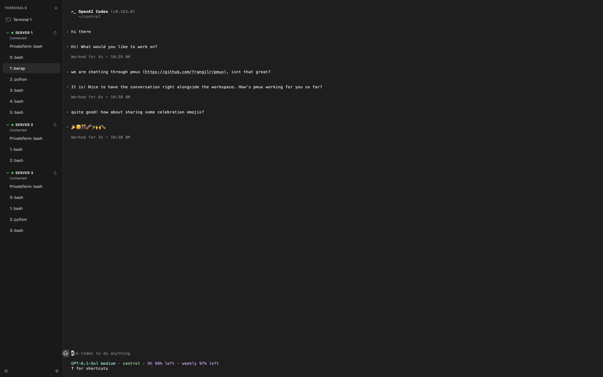

# PrivateMux (pmux, macOS prototype)

Want to run coding agents and experiments side by side across machines, while
keeping your terminal workflow local, private, and inspectable? Welcome to pmux.

I built pmux for my remote tmux workflow and for work where I want to understand
the app's privacy boundaries. It has no account, telemetry, hosted backend, or
automatic updater. It still relies on macOS, WebKit (built-in library), bundled
xterm.js (used by VSCode's emulated terminal), the local shell, and SSH to login
to remote machines; see [SECURITY.md](SECURITY.md) for the limits of those privacy
claims.



Others are welcome to use and modify it under the [MIT license](LICENSE).
It is provided as-is, without warranty, and I accept no liability for its use
to the extent permitted by law. This is a personal prototype, not a security
guarantee or a supported product.

A minimal native macOS application with a clickable SwiftUI terminal sidebar.
Terminal rendering uses pinned **xterm.js**, running in Apple's **WKWebView**.
A tiny local PTY layer spawns `/bin/zsh`. App-managed remote tmux windows use
`/usr/bin/ssh`, your SSH config and agent, and tmux control mode.

**Status: macOS prototype.** On October 22, 2026, the app built with Xcode
27.1 and passed basic local tests for shell input/output, two independent tabs,
switching, rename, and close. With VPN connected, all three remote hosts
connected and displayed tmux windows; input/output, resize, manual reconnect,
individual disable/enable, live window add/rename/remove, and session survival
after app exit were checked.
Treat this as an auditable starting implementation.

## Prerequisites

- macOS 14 (Sonoma) or newer (Apple Silicon or Intel)
- Xcode 16 or newer (full Xcode, not only Command Line Tools)
- Node.js + npm **once**, to fetch pinned browser files for xterm.js
- An internet connection only for that initial npm install, if not cached

You don't need to install Swift separately, a second SSH implementation,
Electron, Ghostty, SwiftTerm, a local tmux, or any server-side software.

Check that Xcode and Node are available:

```sh
xcodebuild -version
node --version
npm --version
```

If `node` isn't available and you use Homebrew, `brew install node` is one option.
For Xcode, install it from Apple's App Store or Apple Developer downloads.
Run `xcode-select --install` only if prompted to install command-line tools;
command-line tools alone won't compile this AppKit application.

## Install bundled terminal renderer (one-time setup)

```sh
cd PrivateTerm
./prepare_xterm.sh
```

This invokes npm with **lifecycle scripts disabled** and copies only these
files (plus license notices) into the application source tree:

- `@xterm/xterm@6.0.0` : `xterm.js` and `xterm.css`
- `@xterm/addon-fit@0.11.0` : `addon-fit.js`

The `frontend/package.json` versions are exact. The script prints the resulting
file SHA-256 hashes. Keep `frontend/package-lock.json` after the first install
and review it if you want to pin tarball integrity as well. You can inspect
`PrivateTerm/Web/vendor/` before compiling. **No npm execution at runtime.**

## Open and build in Xcode

The app appears as **pmux** in the Dock. The Xcode project and existing tmux
session retain their `PrivateTerm` names for compatibility.

```sh
open PrivateTerm.xcodeproj
```

Choose the **PrivateTerm** scheme and **My Mac** destination, then press
**Command-R**. Or use the command line:

```sh
xcodebuild -project PrivateTerm.xcodeproj \
  -scheme PrivateTerm -configuration Debug \
  -destination 'platform=macOS' \
  -derivedDataPath build \
  CODE_SIGNING_ALLOWED=NO build
open build/Build/Products/Debug/pmux.app
```

Because this is a locally built, unsigned development app, macOS may present
permissions or launch prompts. The Xcode target intentionally does **not**
enable App Sandbox: unrestricted interactive shells and SSH do not fit a
minimal sandbox entitlement model. This is a security tradeoff, not a claim
of OS-enforced network isolation.

## Use

- Click an entry in the left sidebar to focus its terminal.
- Click **+** or press **Command-T** to add a new terminal.
- Press **Command-Up/Down** to move through terminals within the current local
  or SSH host group, wrapping within that group. Press **Shift-Command-Up/Down**
  to cross to the previous or next group at its edge, wrapping across groups.
  Collapsed hosts and hosts without available tmux windows are skipped.
- Press **Command-0** for the first local terminal. **Command-1** through
  **Command-9** select the corresponding enabled SSH host in Settings order,
  opening its `bash` tmux window or its first available window. A collapsed
  host expands when selected this way. Disabled hosts are not counted.
- Click a remote tmux window beneath its host to view its active pane.
- Use the gear at the bottom of the sidebar to add, edit, remove, enable, or
  disable SSH servers. New installations have no servers configured. The
  circular arrow beside each enabled host reconnects it manually.
- Right-click a sidebar entry to **Rename** or **Close** it.
- Each entry owns its own zsh process and PTY and remains alive while hidden.
- On any tab, use the same commands you use in Terminal.app:

```sh
ssh gpu-server
# On remote server:
tmux attach -t research
```

When you close a tab, its local shell is terminated and SSH disconnects.
Your detached **remote tmux** session normally survives (subject to remote
configuration), allowing you to reconnect later.

### SSH key passphrase

PrivateMux does not ask for or store your SSH password or key passphrase.
Automatic connections use `BatchMode=yes` and fail if the key is unavailable.
If a key is absent from your SSH agent after a restart, use Terminal.app to
load it once, replacing the example path with your own key:

```sh
/usr/bin/ssh-add --apple-use-keychain ~/.ssh/id_ed25519
/usr/bin/ssh-add -l
```

The first command may request the **key's passphrase**. To let Apple's SSH
client retrieve it from Keychain in future sessions, add `UseKeychain yes` and
`AddKeysToAgent yes` to the relevant host entries in `~/.ssh/config` if they
are not already present. Verify the host key interactively with normal SSH
before relying on automatic connections; PrivateMux enforces
`StrictHostKeyChecking=yes`. Click **Reconnect** on a failed host after loading
the key or connecting to a required VPN.

The app attaches to or creates a regular tmux session called `PrivateTerm` on
each host, then lists windows from all sessions. Closing the app detaches its
control client and leaves those remote sessions running.

## Architecture

```text
SwiftUI native sidebar and SSH settings (MainWindow.swift, SSHSettings.swift)
    |
TerminalSession.swift (one persistent WKWebView per tab)
    |
Local terminal.html + JS + CSS (Web/)  --> @xterm/xterm, @xterm/addon-fit
    |                                      [no CDN/network at runtime]
Tiny message bridge: ready, resize, input/binary, output-drained | base64 output
    |
PTYProcess.swift + PTYShim.c (forkpty, read/write, resize)
    |
/bin/zsh --> optional user-run /usr/bin/ssh
RemoteTmux.swift --> app-managed /usr/bin/ssh --> remote tmux -CC
RemoteTerminalView.swift --> one reused WKWebView for selected remote pane
```

The app delegates SSH authentication and host-key checking to macOS OpenSSH.
It never reads SSH private-key bytes or stores credentials.

## Privacy properties and limitations

**Implemented:**

- No analytics, crash SDK, automatic updater, account or cloud service.
- Browser assets load using `loadFileURL`, never from a CDN.
- Nonpersistent WebKit website data store (see Apple's WKWebsiteDataStore docs).
- CSP blocks external connections, remote script sources, framing, and forms.
- WebView top-level navigation is limited to the bundled terminal page.
- New browser windows are refused.
- The app does not implement an HTTP client, server, socket, or telemetry call.
  It launches one SSH child process per enabled host at startup.
- Terminal screen/scrollback is only held in application/WebKit memory (the app
  does not deliberately persist transcripts to disk).
- Base64-encoded terminal output is sent to a fixed JavaScript function; raw
  terminal content is never interpreted as JavaScript source.

**Not guaranteed:**

- There is NO formal guarantee against data leakage or exploitation. xterm.js,
  WebKit, native PTY processing, your shell startup files, and macOS are in the
  trusted computing base. A vulnerability or malicious dependency remains a risk.
- App Sandbox is **off**, and the app does not prevent zsh/ssh/other child
  processes from connecting to the Internet. This is needed for remote SSH.
- macOS may write system crash diagnostics, swap, or process metadata to disk.
  A nonpersistent WKWebsiteDataStore does not prevent every possible OS write.
- Your ordinary zsh history, SSH config/agent, remote hosts, remote tmux buffers,
  applications, and clipboard have their own privacy behavior.
- PTY reads pause after each 16 KiB output chunk until xterm finishes parsing
  it. This bounds queued output, but input buffering and total WebKit memory
  are not capped. Clipboard/accessibility and specialized terminal protocols
  need Mac testing.
- Basic Mac build and UI tests passed, including 200,000 lines in a visible tab
  and 500,000 lines across a tab switch. The remote smoke test covered tmux
  3.2a on the three named hosts. Remote copy/paste, split-pane layouts, and
  unexpected WebKit network behavior still need broader testing.
  First run it on non-sensitive data.
- Remote tmux windows currently show the active pane only. Split-pane layout
  rendering and tmux copy/choose modes are not implemented.

## Suggested smoke tests on a Mac

1. Xcode builds and launches a window with one responsive terminal.
2. Type `echo hello`, `pwd`, `ls`, and an interactive command (`top` or `vim`).
3. Resize the window and confirm terminal apps adapt correctly.
4. Open two tabs, start a long-running command in one, switch tabs and return.
5. Test paste, selection/copy, arrow keys, backspace, Ctrl-C, and UTF-8 text.
6. Test `ssh yourserver`, verify known-host and ssh-agent behavior, attach tmux.
7. Test detaching remote tmux (Ctrl-B, D) and closing/reopening a local tab.
8. While `ssh` isn't running, observe any unexpected app-originated network
   connections with your preferred network-monitoring or firewall tool.
9. Before using private data, review the source and the exact vendor files.

For ongoing work and detailed acceptance criteria, see `CODEX_HANDOFF.md`.
